<p align="center">
  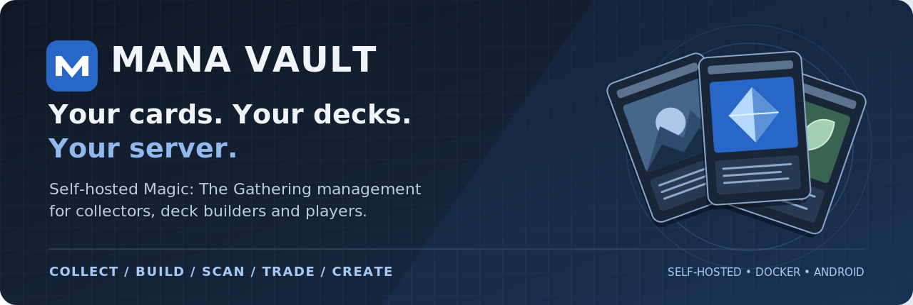
</p>

<h1 align="center">Mana Vault</h1>
<p align="center"><strong>A self-hosted Magic: The Gathering management platform.</strong></p>

<p align="center">
  <a href="https://github.com/Shwhat/mana-vault/releases"></a>
  <a href="https://github.com/Shwhat/mana-vault/pkgs/container/mana-vault"></a>
  <a href="https://github.com/Shwhat/mana-vault/wiki"></a>
  <a href="https://github.com/Shwhat/mana-vault/stargazers"></a>
</p>

<p align="center">
  <a href="#quick-start">Quick start</a> ·
  <a href="#features">Features</a> ·
  <a href="#screenshots">Screenshots</a> ·
  <a href="#android-app">Android</a> ·
  <a href="https://github.com/Shwhat/mana-vault/wiki"><strong>Wiki / User Guide</strong></a> ·
  <a href="https://github.com/Shwhat/mana-vault/issues">Report an issue</a>
</p>

## What is Mana Vault?

Mana Vault brings your Magic collection, decks, trades, purchases, card creation and proxy printing into one application that runs on your own server. Manage your cards from a desktop browser, a mobile browser or the Android app without relying on a third-party collection-hosting account.

The server maintains a local card catalog, collection and deck data in SQLite, with card information from Scryfall and MTGJSON. Your library lives on infrastructure you control.

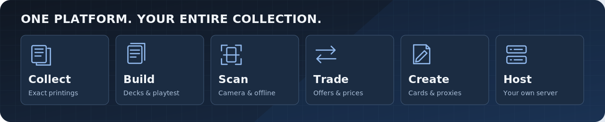

## Features

| Feature | What you can do |
| --- | --- |
| **Collection management** | Organize binders, boxes and wishlists; track exact printings, finishes, conditions, languages, proxies and set completion. |
| **Advanced card search** | Search with Scryfall-style syntax, art and Oracle tags, prices, card text and ownership filters. Browse grid, binder or list layouts. |
| **Deck builder** | Build decks, link owned copies, identify missing cards, check format rules, view statistics and playtest opening hands. |
| **Play table** | Test saved decks against an optional Playmat AI, play engine-approved cards from your hand, play official or original custom cards offline solo, host private two- or four-player Commander tables, or watch as an invited spectator. |
| **Card scanning** | Use your desktop or phone camera to recognize cards, select printings and add them to a collection or deck. |
| **Trading** | Browse other accounts' trade binders, select source and destination collections, compare offers, make counteroffers and complete trades. |
| **Purchase and price tracking** | Record singles, sealed products, sales, receipts and pack openings. Compare market prices and track historical values. |
| **Proxy printing** | Prepare customizable print sheets, print double-sided cards and export PDF or MakePlayingCards assets. |
| **Custom card creator** | Create cards and sets using built-in frames, uploaded artwork, custom symbols and PNG export. |
| **Notes and wiki** | Write linked notes for decks and collections, organize a personal wiki and import or export Markdown pages. |
| **Mobile and offline** | Install the web app or use the Android app for offline card search, scanning and library edits that sync when connected. |
| **Server administration** | Manage accounts, invitations, storage, device sessions, scheduled data updates and whole-server backups. |

Manual tables leave Magic rules to the players, keep opponents' hands and libraries private, and support read-only invited spectators. The Playmat engine is optional and is not included or enabled by default.

### Built for collectors who self-host

- Single Docker container, published for `amd64` and `arm64`.
- Local SQLite database and configurable card-image storage.
- Multiple accounts, shareable collections and decks, and per-account preferences.
- Desktop workspace with dockable panels, keyboard shortcuts and light/dark themes.
- Home dashboard with recent collections and decks, trade activity, scans and Inbox offers.
- Import and export support for Mana Vault, Moxfield, ManaBox, Archidekt, Deckbox, TCGplayer and plain text, with supported formats depending on the data type.

## Screenshots

A look at the actual Mana Vault interface across desktop and Android. Select any screenshot to open the full-resolution image.

### Advanced card search and filters

Search using local card syntax or the dockable Filters panel. Refine results by card type, set, color, legality, artist, artwork tags, role, power, toughness, finish, release year, ownership, price and mana value.

<table>
  <tr>
    <td width="50%" align="center" valign="top"><a href="docs/assets/screenshots/advanced-filters.png">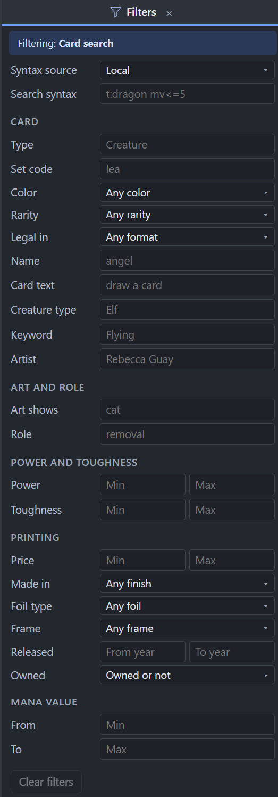</a></td>
    <td width="50%" align="center" valign="top"><a href="docs/assets/screenshots/android-mobile-search.png">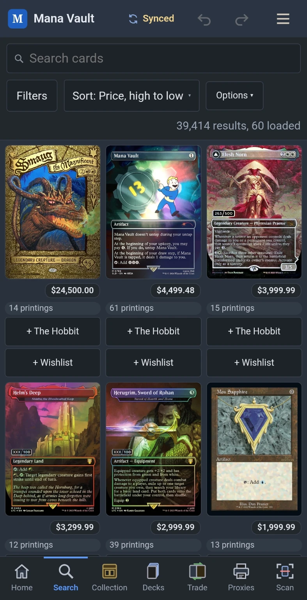</a></td>
  </tr>
  <tr>
    <td><strong>Desktop filters</strong> - refine your search by card properties and printing details.</td>
    <td><strong>Mobile search</strong> - browse cards and add them to collections or wishlists.</td>
  </tr>
</table>

### Collection management

Switch between a card grid, a nine-card binder and a list. Group, sort and filter cards, adjust their size and display prices or finish details.

<table>
  <tr>
    <td width="50%" valign="top"><a href="docs/assets/screenshots/collection-grid.png">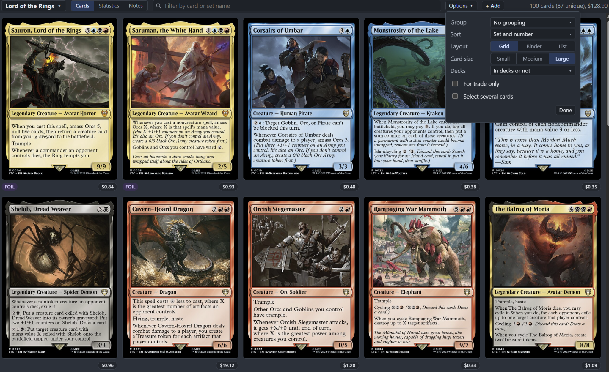</a></td>
    <td width="50%" valign="top"><a href="docs/assets/screenshots/collection-binder.png">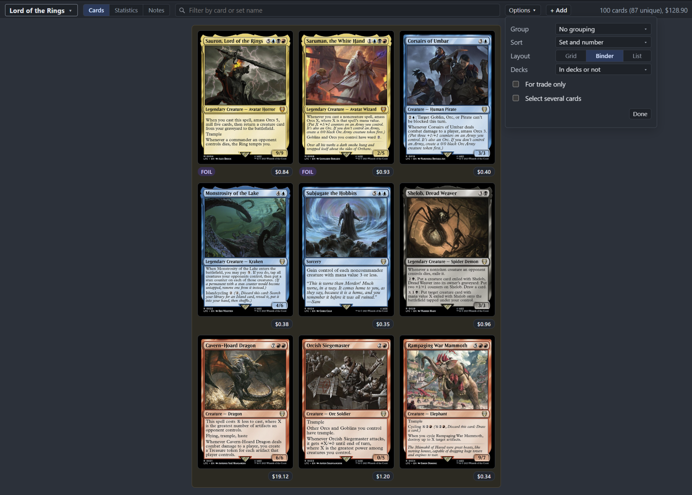</a></td>
  </tr>
  <tr>
    <td><strong>Grid view</strong> - browse large card images.</td>
    <td><strong>Binder view</strong> - browse nine-card pages.</td>
  </tr>
</table>

<details>
<summary>Card layout customization</summary>

Choose where prices, counts, printings and other card details appear.

<p align="center"><a href="docs/assets/screenshots/card-layout.png">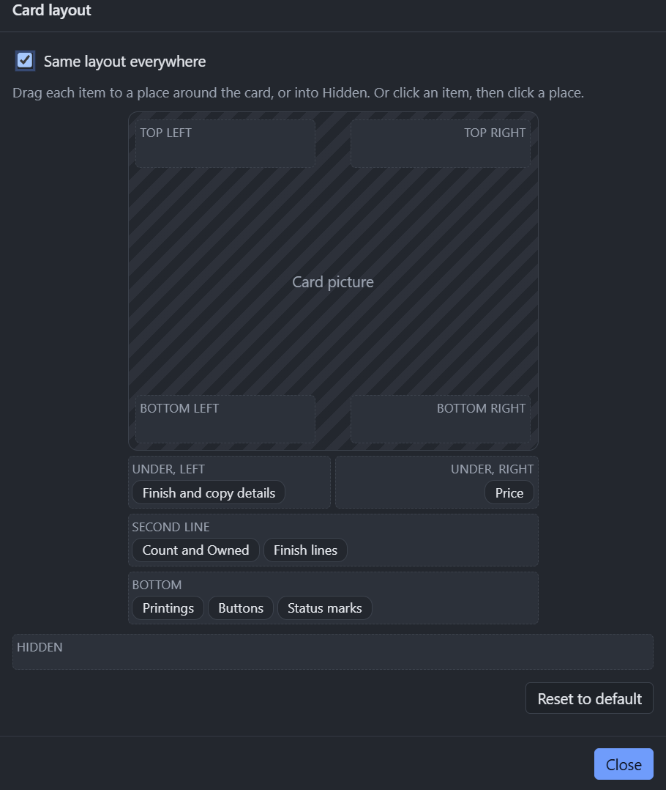</a></p>

</details>

### Deck builder

Build and organize decks with card stacks, format validation, advanced filters, ownership status and a dockable card information panel.

[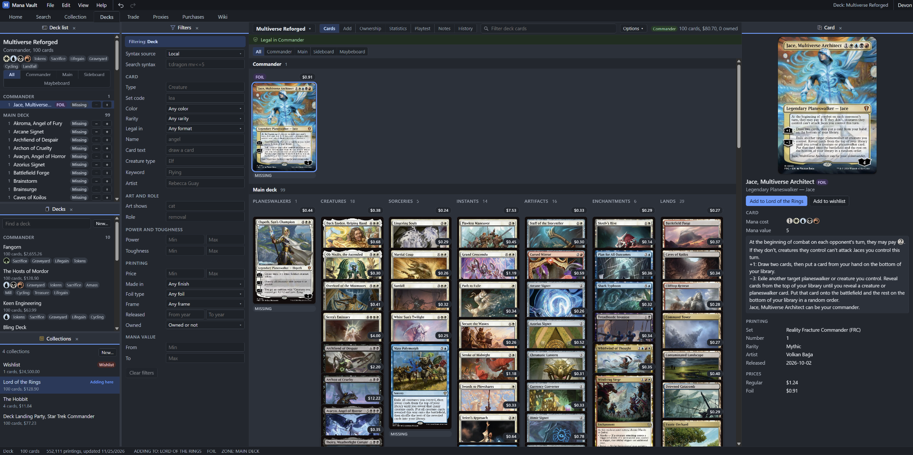](docs/assets/screenshots/deck-builder.png)

<details>
<summary>Preconstructed deck imports</summary>

Find a preconstructed deck and add its decklist.

<p align="center"><a href="docs/assets/screenshots/preconstructed-decks.png">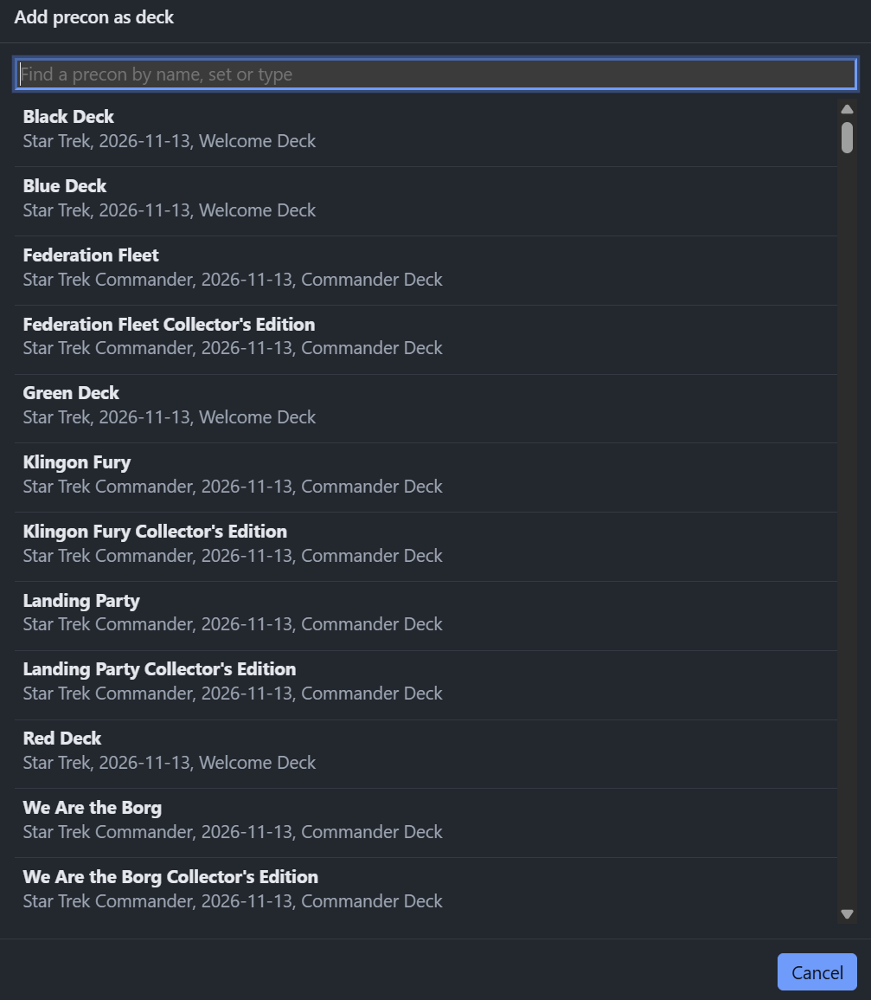</a></p>

</details>

### Android app and live card scanning

Scan physical cards, review detected printings, adjust finish, condition and language, and add the batch to a collection or deck. The Android app supports offline card search and scanning, with synchronization when you reconnect.

<table>
  <tr>
    <td width="50%" align="center" valign="top"><a href="docs/assets/screenshots/android-scan-camera.png">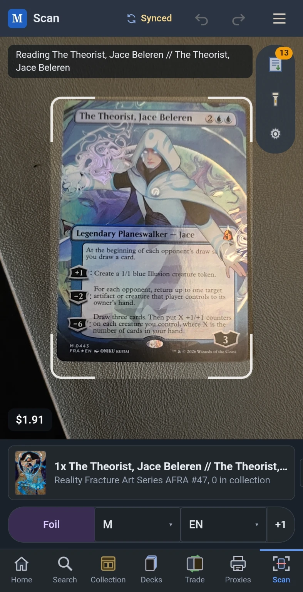</a></td>
    <td width="50%" align="center" valign="top"><a href="docs/assets/screenshots/android-scan-results.png">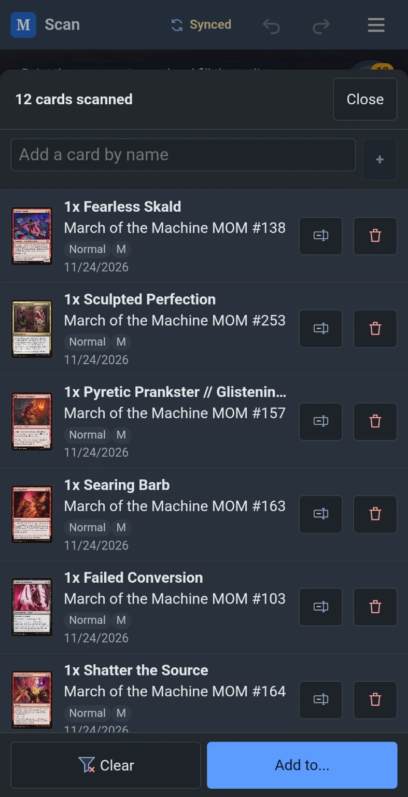</a></td>
  </tr>
  <tr>
    <td><strong>Live scanning</strong> - recognize cards and review prices as you scan.</td>
    <td><strong>Scan sessions</strong> - review, correct and add scanned cards in a batch.</td>
  </tr>
</table>

### Custom card maker

Design cards with custom artwork, frames, mana costs, rules text and flavor text. Preview your work and add it to a print list or export it as a PNG.

[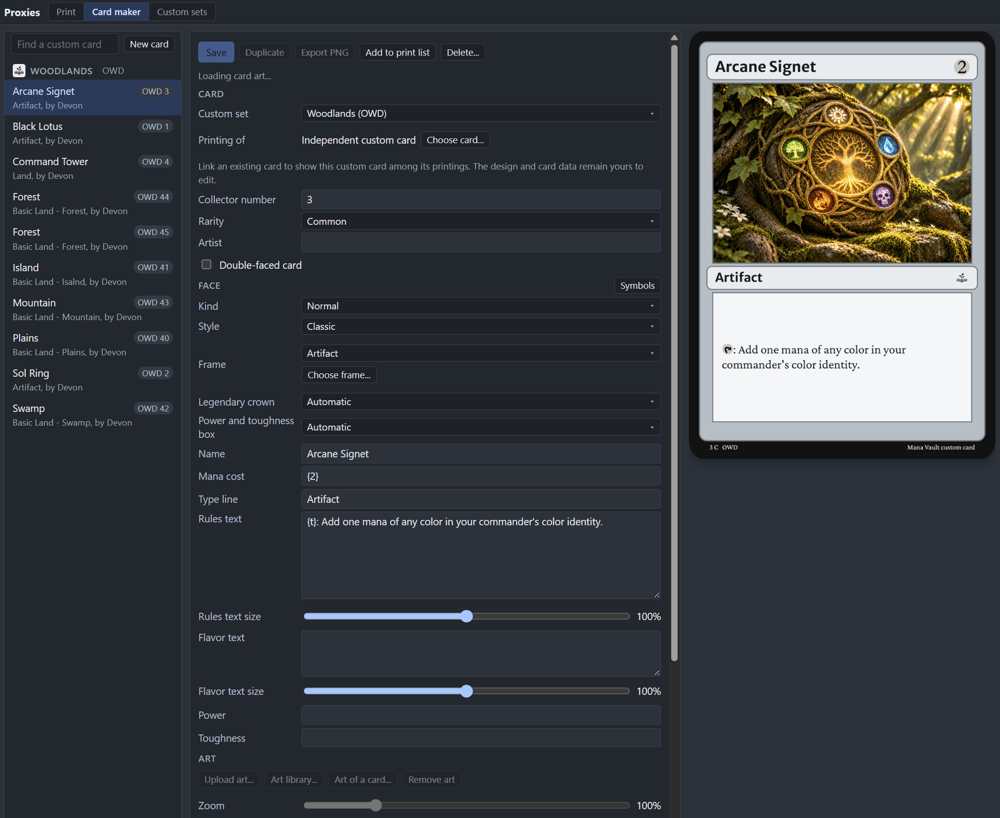](docs/assets/screenshots/card-maker.png)

### Custom sets

Organize your designs into sets with custom codes, collector numbers, rarity-specific symbols and live card previews.

[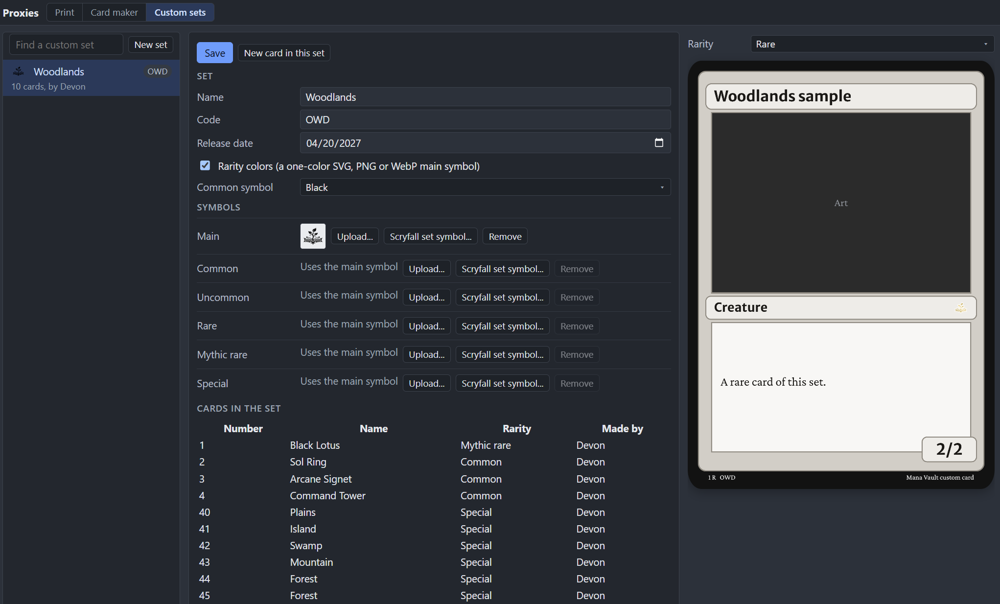](docs/assets/screenshots/custom-sets.png)

### Integrated wiki and notes

Keep deck guides, collection notes and personal reference pages in a searchable wiki. Create and organize pages, import existing documents, capture web pages and use templates. The built-in About Mana Vault guide is available directly in the app.

[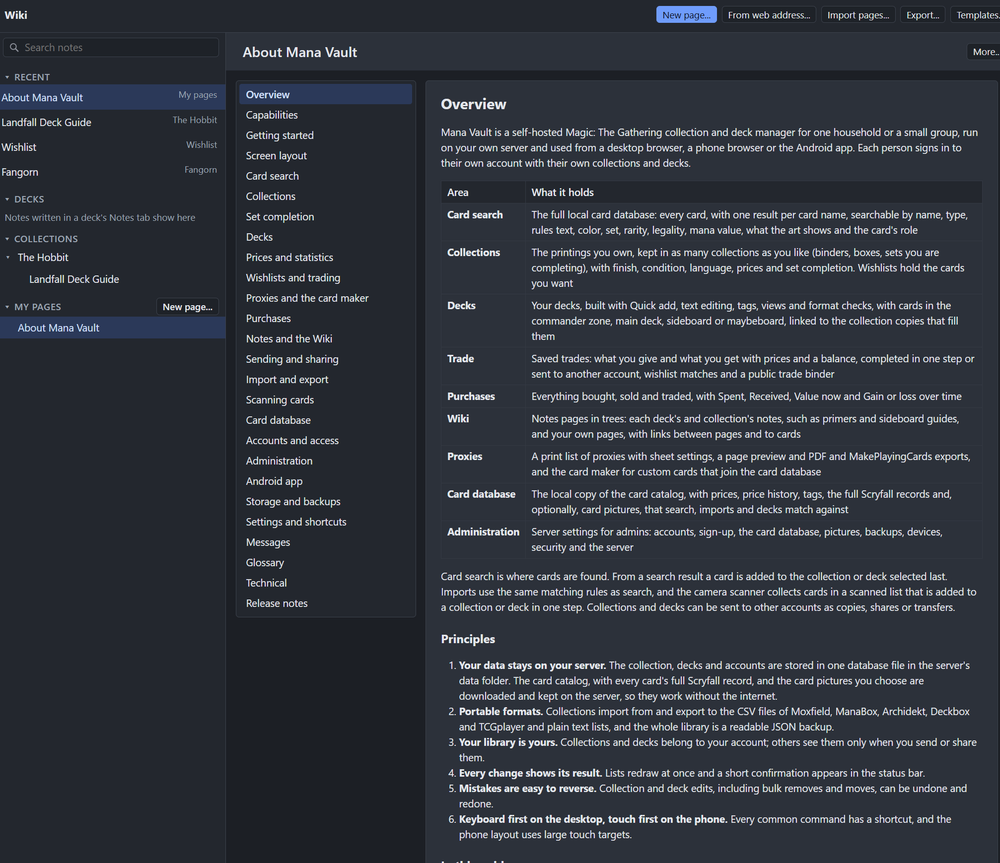](docs/assets/screenshots/integrated-wiki.png)

## Quick start

### Docker Compose

**Requirements:** Docker Engine with the Compose plugin, storage for your database and selected card image sizes, and internet access for the initial card catalog download. The default host port is `3417`.

On your Docker host:

```bash
sudo mkdir -p /opt/mana-vault/data /opt/mana-vault/pictures
cd /opt/mana-vault
sudo curl -fsSLo docker-compose.yml https://raw.githubusercontent.com/Shwhat/mana-vault/main/docker-compose.yml
sudo curl -fsSLo .env.example https://raw.githubusercontent.com/Shwhat/mana-vault/main/.env.example
sudo cp .env.example .env
sudo nano .env
sudo chmod 600 .env
sudo chown -R 65532:65532 /opt/mana-vault/data /opt/mana-vault/pictures
sudo docker compose config -q
sudo docker compose pull
sudo docker compose up -d
```

Open `http://SERVER_IP:3417` in your browser. Create the first account (it becomes the administrator), then follow the setup wizard to download the card database and configure picture storage.

Check the running service:

```bash
sudo docker compose ps
sudo docker compose logs --tail=100
curl -I http://127.0.0.1:3417
```

A `302` redirect to `/login` indicates the service is responding. If image pulls require authentication, configure credentials for GitHub Container Registry.

### Dockhand

Create the data and picture folders with ownership `65532:65532` as shown above. Add a **Git stack** with these settings:

| Setting | Value |
| --- | --- |
| Repository | `https://github.com/Shwhat/mana-vault` |
| Branch | `main` |
| Compose path | `docker-compose.yml` |
| Container image | `ghcr.io/shwhat/mana-vault:latest` |
| Host port | `3417` (configurable) |

Set environment values from [`.env.example`](.env.example), deploy, and open the application. For internet access, use an HTTPS reverse proxy or tunnel; the Android app requires HTTPS. Configure sign-up and invitations in **Administration**.

### Configuration

| Environment variable | Default / purpose |
| --- | --- |
| `MANAVAULT_PORT` | `3417` - published host port |
| `MANAVAULT_DATA_DIR` | `/opt/mana-vault/data` |
| `MANAVAULT_PICTURES_HOST` | `/opt/mana-vault/pictures` |
| `MANAVAULT_SIGNUP` | Empty - managed in Administration (`open`, `invite`, `closed`) |
| `MANAVAULT_SECURE_COOKIE` | Empty (`auto`) - HTTPS-aware session cookies |
| `MANAVAULT_CARD_UPDATE_INTERVAL_HOURS` | Empty - managed in Administration |
| `TZ` | `America/Los_Angeles` |

See [the full deployment and technical reference](https://github.com/Shwhat/mana-vault/blob/4be2a97f0609f66beec7a928f69c5109c0ce16/README.md) for additional configuration and migration instructions.

## Android app

Use Mana Vault on Android 8.0 or newer with your own HTTPS-enabled server. Download the available APK from [GitHub Releases](https://github.com/Shwhat/mana-vault/releases). If only a debug pre-release is listed, it is a development build rather than a stable release.

The Android app supports offline collections, decks, card search and scanning, with synchronization after reconnecting. It also supports receiving trade and sharing offers, importing shared files and launching directly into the scan workflow shown in the screenshots above.

## Updates and backups

Back up your server data before updating. For a command-line installation:

```bash
cd /opt/mana-vault
sudo docker compose pull
sudo docker compose up -d
sudo docker compose logs --tail=100
```

For Dockhand, pull and redeploy the stack or configure automatic image updates. Preserve the data folder; do not delete it or run `docker compose down -v` as part of an update.

Use **Administration → Storage and backups** to schedule and restore server backups. Keep a separate copy of your backups and configuration off the Docker host. The standard scheduled server backup excludes downloadable card pictures. You can also export an account-level JSON backup from the app.

## Documentation

| Resource | Description |
| --- | --- |
| [Mana Vault Wiki / User Guide](https://github.com/Shwhat/mana-vault/wiki) | Getting started, features, workflows and everyday use |
| [Technical reference](https://github.com/Shwhat/mana-vault/blob/4be2a97f0609f66beec7a928f69c5109c0ce16/README.md) | Detailed features, shortcuts, deployment, configuration and Android builds |
| [Releases](https://github.com/Shwhat/mana-vault/releases) | Available Android APKs |
| [Issues](https://github.com/Shwhat/mana-vault/issues) | Bug reports and feature requests |
| [Project handoff](docs/HANDOFF.md) | Code map and development information |

The full guide is also available inside the application under **Help → About Mana Vault**.

## Development

Requires Node.js 22.5 or newer.

```bash
npm install
npm run dev:server    # API at 127.0.0.1:3000
npm run dev:web       # Web interface at localhost:5173
npm run update:cards  # Import the Scryfall catalog
```

Run the checks before submitting changes:

```bash
npm run typecheck
npm test
npx playwright install chromium
npm run test:e2e
```

| Component | Technology |
| --- | --- |
| Web interface | React, TypeScript |
| Server | Fastify, Node.js |
| Database | SQLite |
| Android | Capacitor, Java |
| Deployment | Docker, GitHub Actions |
| Card data | Scryfall, MTGJSON |

## Support and feedback

If Mana Vault is useful to you, consider starring the repository. Report bugs or suggest improvements through [GitHub Issues](https://github.com/Shwhat/mana-vault/issues). Include the application version, steps to reproduce and relevant logs when reporting a problem; remove credentials and private data before posting.

## Acknowledgments

Mana Vault uses card information from [Scryfall](https://scryfall.com/) and [MTGJSON](https://mtgjson.com/). Magic: The Gathering and associated names and artwork belong to their respective rights holders. Mana Vault is an independent project and is not produced by or endorsed by Wizards of the Coast or Scryfall.
