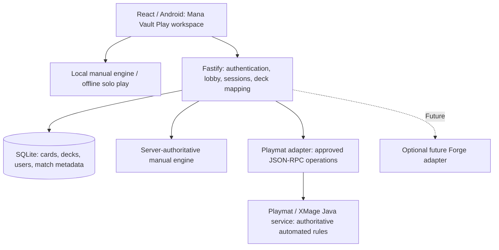

# Mana Vault: Integrated Play Table and MTG Rules Engine

**Status:** Proposed specification for GitHub Copilot. Not implemented or tested against a running engine.

**Primary repository:** https://github.com/Shwhat/mana-vault

## 1. Objective

Expand Mana Vault into a comprehensive, self-hosted Magic: The Gathering platform with a native virtual play table, manual gameplay, automated rules enforcement, AI opponents, multiplayer Commander and deck performance analytics.

Mana Vault remains the primary application, interface, authentication provider, card catalog, collection manager and deck management system. Users should not need a separate application, duplicate decks or a second user-facing login.

**Architectural decision:** Do not rewrite the comprehensive MTG rules engine in TypeScript. Use Playmat's existing XMage-based server for automated games, and build a lightweight TypeScript tabletop engine for manual play and offline goldfishing. Evaluate Forge only as a future option for custom card automation.

## 2. Reference projects and reuse strategy

| Project | Repository | Role | License |
| --- | --- | --- | --- |
| Mana Vault | https://github.com/Shwhat/mana-vault | Primary application and user experience | No license detected at review |
| Playmat | https://github.com/arcanite24/playmat | Web gameplay reference, WebSocket bridge and integration base | MIT |
| XMage | https://github.com/magefree/mage | Automated rules, supported cards, AI and multiplayer | MIT |
| Forge | https://github.com/Card-Forge/forge | Future declarative card scripting and alternative engine research | GPL-3.0 |

Playmat is already a fork of XMage. Do not deploy separate Playmat and XMage engines or fork all three projects without a demonstrated technical requirement. XMage reports support for over 32,000 unique cards, but actual compatibility depends on the pinned engine version.

### Playmat

Inspect and selectively reuse compatible MIT-licensed components from `Mage.Web.Client/src/`, including `protocol/`, `core/` and relevant gameplay UI. Evaluate WebSocket communication, protocol types, game state handling, player decision prompts, battlefield interaction, priority, targeting, combat, stack rendering and reconnection. Adapt the visual design to Mana Vault rather than importing Playmat's entire application, separate collection system, account UI, deck manager or career mode.

API documentation: https://github.com/arcanite24/playmat/blob/master/docs/WebSocketAPI.md

### XMage

Delegate card behavior, mana payments, casting and resolving spells, priority, triggers, activated abilities, continuous and replacement effects, state-based actions, combat, Commander rules, AI and supported format validation to the Playmat-compatible XMage engine.

### Forge

Evaluate Forge's declarative `.txt` card format and custom card architecture separately. Do not copy or distribute Forge code or scripts before reviewing GPL-3.0 obligations and applicable card-data rights. A separate service boundary does not automatically resolve all licensing questions. Do not make Forge a launch dependency or promise arbitrary Oracle-text execution.

## 3. Current Mana Vault baseline

Repository review found version `0.24.8` on `main`. Recheck the actual branch, version and files before implementation.

- React / TypeScript web frontend; Fastify / Node.js backend; SQLite; npm workspaces.
- Scryfall and MTGJSON card catalog, local picture storage, collection/deck ownership, sharing, custom cards and sets.
- Capacitor Android client and offline capabilities.
- Docker, Dockhand, Vitest, Playwright and GitHub Actions.
- Current root workspaces only include `apps/*`; Docker build explicitly copies the server and web package manifests and sources.
- Existing `Playtest()` in `apps/web/src/views/DeckView.tsx` is local goldfishing: shuffle, draw, mulligan, tap, move to graveyard and advance turn. Preserve it and expand or migrate it into a dedicated Play workspace.

Relevant files:

| Path | Purpose |
| --- | --- |
| `docs/HANDOFF.md` | Current project requirements and release conventions |
| `apps/web/src/views/DeckView.tsx` | Deck UI and existing playtest implementation |
| `apps/web/src/deck-rules.ts` | Existing format checks |
| `apps/server/src/decks.ts` | Deck data, zones, format identifiers and access |
| `apps/server/src/auth.ts` | Existing authentication |
| `package.json`, `package-lock.json`, `tsconfig.base.json` | Workspace and build setup |
| `Dockerfile`, `docker-compose.yml`, `.env.example` | Deployment |
| `tests/e2e/`, `playwright.config.ts` | Browser tests |
| `apps/web/src/about/` | Built-in user guide and release documentation |

## 4. Architecture



Create a shared runtime-independent `packages/play-core` TypeScript package for normalized player-facing game views, actions, card instances, zones, manual rules and engine adapter contracts. Keep browser-specific and Node-specific transport outside the shared core. Add `packages/playmat-protocol` for upstream protocol types, parsing, event handling and capabilities. Do not implement a second comprehensive MTG rules engine.

Proposed adapters:

- `ManualEngine`: local offline solo play or server-authoritative multiplayer manual play.
- `XMageEngineAdapter`: server-side communication with Playmat's XMage engine.
- `ForgeEngineAdapter`: reserved future extension point; no implementation required initially.

Use player-specific authorized game views, not omniscient game state. Define typed actions and asynchronous prompts for targets, choices, mana payment, ordering, combat and priority. The adapter contract should represent engine capabilities and unsupported operations explicitly rather than pretending all engines behave identically.

## 5. Proposed file plan

Adapt these proposed paths to the actual repository conventions after inspection.

```text
mana-vault/
  apps/
    web/src/
      views/
        PlayTableView.tsx
        PlayLobbyView.tsx
      components/play/
        Battlefield.tsx
        PlayerHand.tsx
        PlayerBoard.tsx
        GameStack.tsx
        TurnControls.tsx
        GameLog.tsx
        GamePrompt.tsx
    server/src/play/
      routes.ts
      sessions.ts
      lobby.ts
      deck-mapper.ts
      match-history.ts
      playmat-adapter.ts
  packages/
    play-core/
      package.json
      tsconfig.json
      src/
        index.ts
        types.ts
        actions.ts
        zones.ts
        manual-engine.ts
      tests/
    playmat-protocol/
      package.json
      tsconfig.json
      src/
        index.ts
        rpc.ts
        events.ts
        game-view.ts
        capabilities.ts
      tests/
  services/
    play-engine/
      Dockerfile                 # Only if a custom image is needed
      config/
  docs/
    PLAY-TABLE-ARCHITECTURE.md
    PLAY-TABLE-ROADMAP.md
  tests/e2e/
    play-table.spec.ts
  docker-compose.yml             # Optional service or profile
  Dockerfile                     # Shared workspace build support
  package.json                   # Add packages/* workspaces
  package-lock.json
  THIRD-PARTY-NOTICES.md
```

Update package build order, exports, TypeScript settings, Docker copy/install stages, production dependencies and CI so both web and server can consume the shared packages. Verify workspace symlinks and compiled outputs exist in the runtime image.

## 6. Playmat protocol integration

Playmat documents a WebSocket JSON-RPC 2.0 bridge (default internal port `17172`) with positional parameters, connection-bound sessions and server-pushed events. Verify all methods against the pinned version; do not assume signatures are stable.

Initial discovery and integration candidates:

| API operation | Purpose |
| --- | --- |
| `ping`, `getServerState` | Connectivity, version, health and available capabilities |
| `getGameTypes`, `getPlayerTypes`, `getDeckTypes` | Discover supported game formats and seat types |
| `connectUser`, `sessionGetRestoreToken` | Engine session creation and reconnection |
| `serverGetMainRoomId` | Lobby discovery |
| `lookupCards`, `deckValidate` | Card compatibility and validation |
| `roomCreateTable`, `roomJoinTable` | Create and populate a match |
| `matchStart`, `gameJoin` | Start and join a real game |
| `GAME_INIT`, `GAME_UPDATE`, `GAME_SELECT` | State and player-choice events |
| `sendPlayer*` family | Respond to supported game prompts; inspect exact signatures |
| `setCapabilities`, `gameStateResync` | Optional state diffs and resynchronization |
| `gameWatchStart`, `gameWatchStop` | Authorized spectating |

Start with full game snapshots. Add state-diff support only after the basic integration is reliable. For patches, track sequence/base IDs and request a full resync on gaps. Handle asynchronous events, request timeouts, disconnects, duplicate sessions and unknown message types. Never forward arbitrary JSON-RPC methods from browsers.

## 7. Docker and operations

Add an optional `play-engine` service to the existing Compose deployment. Prefer a tested upstream image where suitable; otherwise build a pinned upstream revision. Maintain the existing Mana Vault host port and Dockhand workflow.

- Pin tested engine releases or commits; document update and rollback procedure.
- Use private Docker networking; do not publish raw engine or admin ports.
- Proxy only authenticated and authorized gameplay operations through Mana Vault.
- Persist required engine configuration and data; document backup scope and recovery limitations.
- Set health checks, configurable resource limits and clear engine status indicators.
- Verify both amd64 and arm64 image availability and behavior; do not promise untested architectures.
- Keep collection management, deck editing and local manual play operational if the engine is disabled or unavailable.
- Follow `docs/HANDOFF.md` deployment conventions, including absolute data paths, UID 65532 for the existing app, no bundled reverse proxy or cloudflared and Dockhand-managed updates. Do not assume the upstream Java image can run under the same UID without verification.
- Add Administration controls for engine availability, status, configuration and supported capabilities. Do not allow arbitrary untrusted engine URLs.

## 8. Authentication, security and sessions

Mana Vault accounts remain the authority for table membership. Evaluate Playmat's account provisioning, authentication, single sign-on and restore-token behavior before choosing the implementation.

- No additional user-facing login; never transmit or reuse Mana Vault passwords in the engine.
- Establish a secure, stable mapping between Mana Vault and engine identities; protect credentials and restore tokens server-side.
- Create isolated authorized engine sessions for each player. Do not share one privileged engine session across players.
- Enforce table membership, ownership, private invitations, spectator permissions and existing deck access rules on every operation.
- Validate actions, payload size, session ownership and action freshness; implement rate limits, idempotency or duplicate-action rejection where applicable.
- Ensure browser clients cannot connect directly to the internal engine or invoke unrestricted RPC methods.
- Prevent leakage of hidden cards, library order, private prompts, credentials or restore tokens through responses, events, logs, analytics or replays.
- Handle reconnect, session takeover, expiry, logout and account revocation. Avoid automatic reconnect loops after duplicate-session takeover.
- In manual multiplayer, server authority enforces permissions and state integrity even though players resolve MTG rules themselves.
- Do not silently switch an automated match to manual mode on errors.

## 9. Deck and card integration

Launch games from saved Mana Vault decks. Mana Vault remains the source of truth for deck composition and visual presentation.

Map deck entries using Mana Vault card ID, Scryfall Oracle ID, card name, set code, collector number, quantity, deck zone and format. Preserve exact printings and selected art separately from engine rules identity. Validate mapping against engine card lookups and deck validation; handle alternate names, multiface cards, reprints and unsupported cards explicitly.

Existing Mana Vault zones are `main`, `sideboard`, `commander` and `maybeboard`. Exclude maybeboard cards, map commander/sideboard semantics to the actual engine and selected format, and discover supported format identifiers rather than assuming the names match.

Create an immutable deck snapshot when starting a match. Do not silently drop unsupported cards, substitute unrelated cards or require ownership of physical cards to play. Display compatibility issues before launch and let the user correct the deck or choose manual mode. Gameplay must never alter saved decks, collection quantities or card ownership.

## 10. Gameplay modes

| Mode | Scope |
| --- | --- |
| Solo playtest / goldfish | Local offline play; opening hands, mulligans, draws, mana curve, combos, zones, life and counters |
| Manual table | Official cards, proxies and original custom cards; player-resolved rules; local solo or synchronized multiplayer |
| Automated AI | Saved Mana Vault decks against XMage AI; engine-enforced rules |
| Automated multiplayer | Private online matches; 1v1 first, then four-player Commander |
| Draft and sealed | Future limited formats, using verified integration with existing card and booster data |

Manual gameplay must support drag-and-drop zone movement, shuffle, reveal/search where authorized, card taps, attachments, face-down cards, counters, tokens, copies, dice, coin flips, life, commander damage and turn tracking. Define visibility and consent policies for manual games. Any undo or take-back mechanism in multiplayer must avoid leaking hidden information and respect other players' consent.

Rules-enforced gameplay delegates legal actions, mana, spell resolution, stack, triggers, combat, Commander tax/damage and other rules to the engine. UI controls submit intent and render accepted state, not locally invented game outcomes.

## 11. Native Play workspace

Add a top-level **Play** mode, accessible from the main navigation and from saved decks. Preserve existing app conventions and shared card rendering.

Lobby: create table, select game mode and format, choose a saved deck, invite users, configure supported AI seats, join active matches, reconnect, view match history and inspect engine status.

Table interface:

- Player boards for 1v1 and multiplayer; do not hardcode two players.
- Battlefield, hand, library, graveyard, exile, command zone and engine-provided additional zones.
- Visible stack, game log, active player, turn, phase and priority indicators.
- Pass priority, configurable auto-pass stops and phase controls appropriate to the mode.
- Life totals, mana pool, poison, energy, counters, commander tax and damage.
- Attack/block and targeting indicators; card previews, contextual actions and attachments.
- Engine-driven choice, target, mana, ordering and ability selection dialogs.
- Tokens, zone browsing, concede/restart controls as appropriate.
- Desktop, tablet and Android layouts with touch-friendly controls and accessible keyboard navigation.
- Existing Mana Vault themes, picture storage, menus, dockable panels and shared card components.

Suggested four-player layout: opponent boards across the top or around the table, player's battlefield in the main area, hand at the bottom, stack and game log in a collapsible side panel, turn/priority bar at the top. On smaller screens, support switching between opponent boards and expanding the stack and prompts.

## 12. Custom cards

Distinguish cosmetic customization from original mechanics:

1. Alternative artwork or a proxy of an existing card: allow explicit mapping to a supported engine rules identity while preserving selected artwork.
2. Original card mechanics: support in manual play immediately. Automated support requires structured implemented abilities and compatibility tests.

Do not infer executable behavior from rules text alone. Future work can evaluate a sandboxed structured scripting model or a separately licensed Forge-compatible adapter. Never execute arbitrary user-supplied JavaScript. Do not advertise complete Forge compatibility without testing it.

## 13. Match history and analytics

Store Mana Vault-owned metadata in SQLite: game and match IDs, player identities, immutable deck snapshots, deck IDs, format, mode, engine version, start/end times, duration, turn count, outcome, opponents and termination reason. Add reliable metrics and per-deck win rates where supported. Separate manual, AI and human multiplayer results.

Apply access controls and retention policies to history and replays. Store only authorized data. Distinguish network reconnection from recovery following an engine or server restart. Do not claim persistent active-game recovery until experimentally verified. Report interrupted matches honestly.

## 14. Implementation roadmap

| Phase | Deliverables | Acceptance gate |
| --- | --- | --- |
| 1: Technical integration | Architecture decision, pinned engine, shared contracts, secure sessions, deck mapping, minimal integration client | Complete one real automated game against AI with a saved Mana Vault deck |
| 2: Native gameplay | Play workspace, lobby, battlefield, prompts, stack, targeting, combat and turn controls | Complete a real game using the native UI without the separate Playmat client |
| 3: Manual tabletop | Expanded goldfishing, custom cards, tokens, counters, offline solo and synchronized manual state | Complete a manual game including an original custom card; verify offline solo |
| 4: Multiplayer Commander | Invitations, private lobbies, 1v1, four-player tables, spectators and reconnect | Complete private 1v1 and four-player Commander games; verify no hidden-state leaks |
| 5: Analytics | Match history, immutable deck snapshots, win rates and authorized replay support | Results survive app restart and remain associated with original deck snapshots |
| 6: Advanced formats | Draft, sealed, Cube, tournaments, AI configuration and practice scenarios | Validate each supported format independently |
| 7: Custom rules | Evaluate original structured scripting or Forge integration | Licensing decision and isolated proof of concept; no unverified compatibility claims |

## 15. Phase 1 implementation instructions for Copilot

Begin with a technical assessment, not a wholesale application rewrite.

1. Read current `docs/HANDOFF.md`, existing architecture, workspace build and repository instructions. Inspect Playmat's WebSocket API, authentication implementation, frontend protocol source and server packaging. Review actual upstream licenses.
2. Document the pinned revision, compatibility matrix, identity strategy, security boundary, deployment approach and risks in `docs/PLAY-TABLE-ARCHITECTURE.md`. Record the planned phases in `docs/PLAY-TABLE-ROADMAP.md`.
3. Propose the exact file plan and obtain approval under the existing project workflow before changing application code.
4. Once authorized, scaffold `play-core` and `playmat-protocol` with typed contracts, tests and workspace/build integration.
5. Establish an isolated development engine service and verify real health, connection, protocol compatibility and available formats.
6. Implement secure per-user session mapping, card lookup and deck conversion/validation using one saved Mana Vault deck. Test unsupported cards and deck authorization.
7. Build a minimal integration harness that creates a table, adds the human and AI seats, starts a match, receives authorized game state, submits valid player responses and completes a real game.
8. Test disconnect/reconnect, error handling, engine unavailability and hidden-information isolation. Do not treat mocked responses or a health check as proof of a completed real game.
9. Report changed files, commands run, results, remaining limitations and whether Phase 1 acceptance criteria actually passed. Do not proceed to later phases without reviewing the result.

### Phase 1 acceptance criteria

- Existing Mana Vault functionality remains operational without the engine.
- A pinned Playmat/XMage service runs and reports health.
- Mana Vault users authenticate through a verified identity bridge without a duplicate login or password sharing.
- A saved deck maps correctly and validates against the engine; unsupported cards produce actionable errors.
- A real AI game reaches a genuine engine-reported terminal result using the integration harness.
- Player-authorized game views and prompts do not expose other players' hidden information.
- A disconnected player can reconnect within the supported window, or receives a clear documented limitation.
- Game actions do not modify original saved deck or collection data.
- Tests and build results are recorded accurately; any unverified architecture, behavior or deployment is explicitly identified.

## 16. Testing and release requirements

Use Vitest and Playwright plus a pinned live-engine integration suite. Use mocked protocol responses for deterministic unit tests, not as a substitute for live integration tests. Include regression coverage for:

- Deck conversion, exact printing mapping, supported formats, unknown cards, sideboard/commander handling and maybeboard exclusion.
- Session authorization, cross-user isolation, spectator access, hidden cards, private prompts, stale/duplicate actions and credential redaction.
- Protocol parsing, asynchronous events, errors, state patches, reconnect, resync and engine outages.
- Manual zone movement, tokens, counters, custom cards and offline solo play.
- Real automated card interactions: Lightning Bolt, Counterspell, Giant Growth, Divination, Llanowar Elves, Grizzly Bears, Serra Angel, Glorious Anthem, Doom Blade and Soul Warden; include basic lands, combat, state-based actions, triggers and continuous effects. These are integration verification cases, not instructions to reimplement their rules.
- Private 1v1 and four-player Commander, including commander-specific rules.
- Deck snapshot immutability, original collection/deck preservation and match history authorization.

Follow the existing handoff and approval workflow. At the reviewed revision it requires explicit build authorization, coordinated version increments, README and About guide updates, handoff updates, server/Android releases and tests before delivery. It also forbids em dashes in repository text. Recheck these rules at implementation time.

Required checks include `npm run typecheck`, `npm test`, `npm run test:e2e` and `npm run test:all`; use the documented Chrome override where necessary. Validate Docker builds, engine-enabled and engine-disabled deployment, and Android CI. Do not push or merge without the authorization required by the repository workflow.

## 17. Licensing and open decisions

- Preserve MIT copyright and license notices for reused Playmat and XMage code; review dependency notices as well.
- Mana Vault had no detected repository license at the time of review. The owner must decide whether to adopt MIT or another license; do not change licensing without approval.
- Forge is GPL-3.0; review distribution, derivative-work, source availability and script-library obligations before any reuse. Obtain qualified legal advice if needed.
- Card artwork, rules text and game trademarks have separate rights considerations. Software licenses do not automatically grant card-data or art rights.
- Confirm the Playmat/XMage upstream maintenance strategy, supported Java runtime, supported Docker architectures, resource requirements and actual single sign-on/provisioning implementation.
- Verify engine-format coverage, multiplayer UI behavior, AI support for desired formats, custom-art mapping and restart recovery. These are proposed capabilities, not already established facts for Mana Vault.

## 18. Final recommendation

Use Playmat as the gameplay integration foundation, XMage as the automated rules engine, and Mana Vault as the unified native user experience. Keep a lightweight TypeScript manual tabletop for offline goldfishing and custom cards. Reserve Forge for a separately assessed future custom-rules integration.

Do not begin building a full TypeScript MTG rules engine unless a specific, demonstrated integration limitation makes it necessary.

**Current status:** Repository source and documentation were reviewed. No repository files were changed, no engine was deployed, and no live game was tested during preparation of this specification. Proposed paths, phases, UI and deployment decisions require verification and owner approval before implementation.
